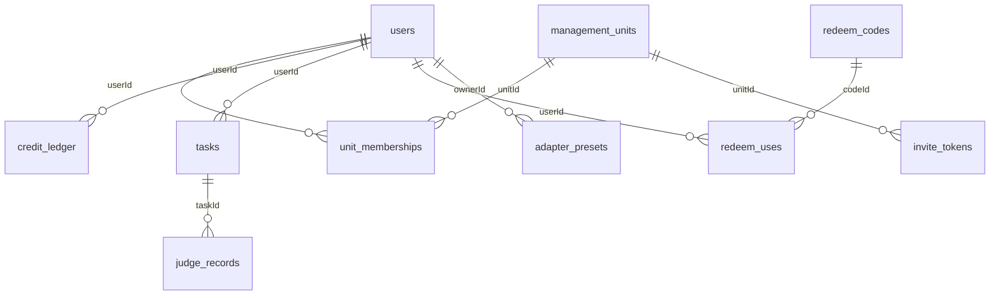

# 数据库设计

服务端使用单文件 SQLite（`better-sqlite3`），默认路径 `server/data/app.db`，可用 `DB_PATH` 覆盖。TypeORM 以 `synchronize: true` 启动，启动时自动建表/加列；改字段前先备份数据库。

- 时间字段统一为 `datetime`，SQLite 中存 `YYYY-MM-DD HH:MM:SS`。
- 布尔字段为 `boolean`，SQLite 中存 `0/1`。
- `simple-json` 字段在 SQLite 中是 `TEXT`，内容是 JSON 字符串。
- 表之间**没有数据库外键**，关联由服务端按 `userId`、`taskId` 等整数维护；删除任务时服务端会一并删除它的评分记录。

## 关系概览



> 图中的连线是逻辑关系，不是数据库外键。

## users

| 列 | 类型 | 约束/默认 | 说明 |
| --- | --- | --- | --- |
| `id` | INTEGER | PK，自增 | 用户 ID |
| `username` | VARCHAR(32) | 唯一，非空 | 登录名 |
| `passwordHash` | VARCHAR | 非空 | scrypt 哈希 |
| `role` | VARCHAR | 默认 `user` | `user` / `admin` |
| `credits` | INTEGER | 默认 `0` | 当前可用评分次数，不能为负 |
| `disabled` | BOOLEAN | 默认 `false` | 停用后旧 JWT 立即失效 |
| `tokenVersion` | INTEGER | 默认 `0` | 改密码/停用时 +1，用于让旧 JWT 失效 |
| `createdAt` | DATETIME | 自动 | 创建时间 |
| `lastLoginAt` | DATETIME | 可空 | 最近登录时间 |

## management_units

| 列 | 类型 | 约束/默认 | 说明 |
| --- | --- | --- | --- |
| `id` | INTEGER | PK，自增 | 管理单元 ID |
| `name` | VARCHAR(100) | 唯一，非空 | 单元名称 |
| `description` | VARCHAR | 默认空串 | 描述 |
| `ownerId` | INTEGER | 非空 | 创建者/所有者用户 ID |
| `enabled` | BOOLEAN | 默认 `true` | 停用后邀请令牌不可用 |
| `createdAt` | DATETIME | 自动 | 创建时间 |
| `updatedAt` | DATETIME | 自动 | 更新时间 |

## unit_memberships

| 列 | 类型 | 约束/默认 | 说明 |
| --- | --- | --- | --- |
| `id` | INTEGER | PK，自增 | 成员关系 ID |
| `unitId` | INTEGER | 非空 | 管理单元 ID |
| `userId` | INTEGER | 非空 | 用户 ID |
| `role` | VARCHAR | 默认 `grader` | `owner` / `manager` / `grader` / `viewer` |
| `createdAt` | DATETIME | 自动 | 加入时间 |

唯一索引：`(unitId, userId)`，同一用户在同一单元只有一条成员关系。

## credit_ledger

每一次额度变化都写一条流水；`balanceAfter` 是变更后的余额。

| 列 | 类型 | 约束/默认 | 说明 |
| --- | --- | --- | --- |
| `id` | INTEGER | PK，自增 | 流水 ID |
| `userId` | INTEGER | 非空 | 用户 ID |
| `delta` | INTEGER | 非空 | 变化量，正数增加、负数扣减 |
| `balanceAfter` | INTEGER | 非空 | 变更后的余额 |
| `reason` | VARCHAR | 非空 | `register` / `redeem` / `judge` / `refund` / `admin` |
| `refId` | INTEGER | 可空 | 关联记录/兑换码 ID |
| `note` | VARCHAR | 默认空串 | 说明 |
| `createdAt` | DATETIME | 自动 | 发生时间 |

索引：`(userId, createdAt)`。

## redeem_codes

| 列 | 类型 | 约束/默认 | 说明 |
| --- | --- | --- | --- |
| `id` | INTEGER | PK，自增 | 兑换码 ID |
| `code` | VARCHAR(32) | 唯一，非空 | 形如 `EG-AB12-CD34` |
| `credits` | INTEGER | 非空 | 每个用户兑换后获得的次数 |
| `maxUses` | INTEGER | 默认 `1` | 最多可被多少个不同用户使用 |
| `usedCount` | INTEGER | 默认 `0` | 已使用次数 |
| `expiresAt` | DATETIME | 可空 | 过期时间，空表示不过期 |
| `disabled` | BOOLEAN | 默认 `false` | 是否停用 |
| `note` | VARCHAR | 默认空串 | 备注 |
| `createdBy` | INTEGER | 可空 | 创建它的管理员 ID |
| `createdAt` | DATETIME | 自动 | 创建时间 |

## invite_tokens

注册必须携带邀请令牌。数据库只存 SHA-256 哈希，明文只在创建响应里出现一次。

| 列 | 类型 | 约束/默认 | 说明 |
| --- | --- | --- | --- |
| `id` | INTEGER | PK，自增 | 令牌 ID |
| `tokenHash` | VARCHAR(64) | 唯一，非空 | 明文的 SHA-256 |
| `unitId` | INTEGER | 非空 | 注册后加入的管理单元 |
| `credits` | INTEGER | 默认 `0` | 注册赠送次数 |
| `maxUses` | INTEGER | 默认 `10` | 最多可使用次数 |
| `usedCount` | INTEGER | 默认 `0` | 已使用次数 |
| `expiresAt` | DATETIME | 可空 | 过期时间 |
| `disabled` | BOOLEAN | 默认 `false` | 是否停用 |
| `note` | VARCHAR | 默认空串 | 备注 |
| `createdBy` | INTEGER | 可空 | 创建它的管理员 ID |
| `createdAt` | DATETIME | 自动 | 创建时间 |

## redeem_uses

记录“哪个用户用过哪个兑换码”，防止同一用户重复兑换。

| 列 | 类型 | 约束/默认 | 说明 |
| --- | --- | --- | --- |
| `id` | INTEGER | PK，自增 | 记录 ID |
| `codeId` | INTEGER | 非空 | `redeem_codes.id` |
| `userId` | INTEGER | 非空 | 用户 ID |
| `createdAt` | DATETIME | 自动 | 使用时间 |

唯一索引：`(codeId, userId)`。

## tasks

一道题的阅卷任务。任务结构对齐咖喱阅卷的 `taskInfo`，`exam` / `question` / `majorInput` 三列是结构来源；扁平的 `examTitle` / `questionNo` / `maxScore` 等列是索引和模型提示词用的冗余。

| 列 | 类型 | 约束/默认 | 说明 |
| --- | --- | --- | --- |
| `id` | INTEGER | PK，自增 | 任务 ID（对外的 `taskId`） |
| `userId` | INTEGER | 非空 | 所属用户 |
| `platformHost` | VARCHAR | 默认空串 | 平台 host，如 `mark.xiaoxianai.cn` |
| `judgeId` | VARCHAR(40) | 唯一，可空 | 服务端签发的评分标识，`j_` + 32 hex |
| `exam` | SIMPLE-JSON | 可空 | `{ exam, subject, q_index }` |
| `question` | SIMPLE-JSON | 可空 | `{ type, content, extra? }` |
| `majorInput` | SIMPLE-JSON | 可空 | `{ key, name, content }` |
| `examTitle` | VARCHAR | 默认空串 | `exam.exam` 的冗余 |
| `questionNo` | VARCHAR | 默认空串 | `exam.q_index` 的冗余 |
| `subject` | VARCHAR | 默认 `语文` | `exam.subject` 的冗余 |
| `questionType` | VARCHAR | 默认空串 | `question.type` 的冗余 |
| `maxScore` | REAL | 非空 | `question.content.score` 的冗余 |
| `scoreStep` | REAL | 默认 `1` | 分数步长：0.5 / 1 / 2 / 5 |
| `questionText` | TEXT | 默认空串 | `question.content.title` 的冗余 |
| `referenceAnswer` | TEXT | 默认空串 | `question.content.reference` 的冗余 |
| `rubric` | TEXT | 默认空串 | `majorInput.content` / `question.content.command` 的冗余 |
| `createdAt` | DATETIME | 自动 | 创建时间 |
| `updatedAt` | DATETIME | 自动 | 更新时间 |

索引：`(userId, platformHost, examTitle, questionNo)`；`judgeId` 唯一索引。

### exam / question / majorInput

```json
{
  "exam": { "exam": "2026 秋季期中考试 高二语文", "subject": "语文", "q_index": "17" },
  "question": {
    "type": "阅读理解",
    "content": {
      "score": 6,
      "title": "概括文章内容",
      "reference": "思念外婆，怀念乡村生活",
      "command": "答出一点得 2 分，答出三点得满分"
    }
  },
  "majorInput": { "key": "command", "name": "评分细则", "content": "答出一点得 2 分，答出三点得满分" }
}
```

`question.content` 按题型放不同字段，常用字段：

| 字段 | 类型 | 说明 |
| --- | --- | --- |
| `score` | number | 满分，0.5–200，必填 |
| `title` | string | 题干 |
| `reference` | string | 参考答案 |
| `command` | string | 评分细则/命令 |
| `resource` | string | 阅读材料 |
| `target` | string | 作文题目/目标 |
| `target_command` | string | 作文要求 |
| `keywords` | string | 关键词 |

`majorInput.key` 指向 `question.content` 中作为评分依据的字段，默认 `command`。

## judge_records

一份答卷的评分记录。**不保存图片**，只保存图片的 SHA-256。

| 列 | 类型 | 约束/默认 | 说明 |
| --- | --- | --- | --- |
| `id` | INTEGER | PK，自增 | 内部记录 ID |
| `gradingId` | VARCHAR(40) | 唯一，可空 | 对外评分标识，`g_` + 32 hex |
| `userId` | INTEGER | 非空 | 评分发起用户 |
| `taskId` | INTEGER | 非空 | `tasks.id` |
| `imageSha256` | VARCHAR(64) | 非空 | 答卷图片哈希，用于缓存/去重 |
| `status` | VARCHAR | 非空 | `done` / `failed` |
| `aiScore` | REAL | 可空 | 模型原始分 |
| `confidence` | REAL | 可空 | 0–1 置信度 |
| `reasons` | SIMPLE-JSON | 可空 | 评分理由数组 |
| `comment` | TEXT | 默认空串 | 总评 |
| `ocrText` | TEXT | 默认空串 | 识别出的答卷文字 |
| `finalScore` | REAL | 可空 | 老师确认后的分数（对外 `modifiedScore`） |
| `autoSubmitted` | BOOLEAN | 默认 `false` | 是否自动提交（对外 `isAuto`） |
| `charged` | BOOLEAN | 默认 `false` | 是否已扣费 |
| `model` | VARCHAR | 默认空串 | 模型名 |
| `latencyMs` | INTEGER | 默认 `0` | 评分耗时 |
| `error` | TEXT | 默认空串 | 失败原因 |
| `createdAt` | DATETIME | 自动 | 创建时间 |
| `confirmedAt` | DATETIME | 可空 | 老师确认时间 |

索引：`(userId, taskId, imageSha256)`、`(createdAt)`；`gradingId` 唯一索引。

## adapter_presets

平台适配预设：按 host（和可选的路径片段）匹配，内容是选择器配置。

| 列 | 类型 | 约束/默认 | 说明 |
| --- | --- | --- | --- |
| `id` | INTEGER | PK，自增 | 预设 ID |
| `name` | VARCHAR | 非空 | 预设名称 |
| `hostPattern` | VARCHAR | 非空 | 精确 host 或主域，如 `xiaoxianai.cn` 匹配 `www.xiaoxianai.cn` |
| `pathPattern` | VARCHAR | 默认空串 | 路径包含的片段，空表示不限制 |
| `config` | SIMPLE-JSON | 非空 | `AdapterConfig`，见 `docs/implementation-notes.md` |
| `scope` | VARCHAR | 默认 `private` | `public` / `private` |
| `ownerId` | INTEGER | 可空 | 私有预设的拥有者；公共预设为 `NULL` |
| `enabled` | BOOLEAN | 默认 `true` | 是否启用 |
| `note` | VARCHAR | 默认空串 | 备注 |
| `createdAt` | DATETIME | 自动 | 创建时间 |
| `updatedAt` | DATETIME | 自动 | 更新时间 |

索引：`hostPattern`。

## 启动迁移

`TaskInfoService` 在应用启动时执行一次幂等迁移：

1. 给 `tasks.judgeId` 为空的行补 `j_` + 32 位随机 hex；
2. 给 `judge_records.gradingId` 为空的行补 `g_` + 32 位随机 hex；
3. 把 `exam` 为 `NULL` 的旧任务从扁平列回填成 `exam` / `question` / `majorInput`。

新写入的数据不依赖这次迁移；迁移只是让旧库能直接升级。由于 `synchronize: true`，新增列都是可空的，避免在已有数据上启动失败。
